# Relaciones principales

Diagrama conceptual del 12 de octubre de 2026. Las tablas auxiliares y las columnas completas se describen en `modelo-base-datos.md`.

```mermaid
erDiagram
    PREPARACIONES ||--o{ RECETAS_DOCUMENTADAS : tiene
    RECETAS_DOCUMENTADAS ||--o{ RECETA_INGREDIENTES : utiliza
    INGREDIENTES ||--o{ RECETA_INGREDIENTES : participa
    INGREDIENTES ||--o{ VARIEDADES : tiene
    VARIEDADES o|--o{ RECETA_INGREDIENTES : especifica
    INGREDIENTES ||--o{ INGREDIENTE_TEMPORADAS : presenta
    TERRITORIOS ||--o{ INGREDIENTE_TEMPORADAS : contextualiza
    PERSONAS ||--o{ RECETA_PERSONAS : participa
    RECETAS_DOCUMENTADAS ||--o{ RECETA_PERSONAS : documenta
    RECETAS_DOCUMENTADAS ||--o{ RECETA_TERRITORIOS : vincula
    TERRITORIOS ||--o{ RECETA_TERRITORIOS : ubica
    TERRITORIOS ||--o| MUNICIPIOS_PUEBLA : especializa
    MERCADOS ||--o{ MERCADO_UBICACIONES : conserva
    MUNICIPIOS_PUEBLA ||--o{ MERCADO_UBICACIONES : contiene
    MERCADO_UBICACIONES ||--o{ MERCADO_HORARIOS : opera
    MERCADOS ||--o{ MERCADO_INGREDIENTES : ofrece
    INGREDIENTES ||--o{ MERCADO_INGREDIENTES : se_vende
    IMPORTACIONES ||--o{ IMPORTACION_CANDIDATOS : obtiene
    MERCADOS o|--o{ IMPORTACION_CANDIDATOS : coincide
    EXPEDIENTES_LEGALES ||--o{ EXPEDIENTE_INSTRUMENTOS : origina
    INSTRUMENTOS_LEGALES ||--o{ EXPEDIENTE_INSTRUMENTOS : resulta
    INSTRUMENTOS_LEGALES ||--o{ INSTRUMENTO_TERRITORIOS : abarca
    TERRITORIOS ||--o{ INSTRUMENTO_TERRITORIOS : delimita
    PODCASTS ||--o{ EPISODIOS : contiene
    EPISODIOS ||--o{ EPISODIO_PERSONAS : incluye
    PERSONAS ||--o{ EPISODIO_PERSONAS : participa
    EPISODIOS ||--o{ EPISODIO_ARCHIVOS : utiliza
    ARCHIVOS ||--o{ EPISODIO_ARCHIVOS : aloja
    PERSONAS ||--o{ CONSENTIMIENTOS : autoriza
    REGISTROS ||--o{ REGISTRO_REVISIONES : conserva
    REGISTRO_REVISIONES ||--o{ EVALUACIONES_REVISION : recibe
    REGISTRO_REVISIONES ||--o{ PUBLICACIONES : publica
    USUARIOS ||--o{ EVALUACIONES_REVISION : valida
    USUARIOS ||--o{ PUBLICACIONES : publica
    USUARIOS ||--o{ USUARIO_ROLES : tiene
    ROLES ||--o{ USUARIO_ROLES : asigna
    ROLES ||--o{ ROL_PERMISOS : concede
    PERMISOS ||--o{ ROL_PERMISOS : habilita
```

- Cada ficha publicable tiene un `registro_id` único. El registro debe corresponder al tipo de ficha y no puede compartir identidad con otra entidad de dominio.
- El diagrama muestra varias ubicaciones históricas por mercado; inicialmente solo una puede estar vigente.
- Varias publicaciones pueden existir en el historial; solo una puede estar activa por registro.
- Un instrumento puede existir sin expediente disponible. Una receta puede existir sin personas identificadas.
- La pertenencia de territorios es una relación independiente que admite regiones superpuestas.
- La autovalidación está permitida si el usuario tiene los permisos; las acciones conservan responsables independientes.
- El modelo de instantáneas mantiene separadas la versión de trabajo y la versión pública aprobada.
